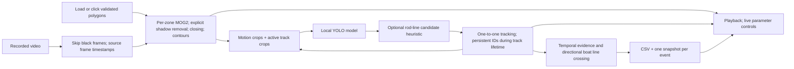

# Current architecture



`main.py` owns video I/O, lifecycle, display and run outputs. `zones.py` validates
or creates polygons. `motionDetection.py` proposes regions; the proposals do
not classify objects. `detector.py` adapts local Ultralytics weights and maps
crop coordinates back to the full frame. `rod_detection.py` optionally adds
tentative geometry evidence. `pipeline.py` schedules inference, filters objects
by zones and revisits active tracks. `tracker.ObjectTracker` performs one-to-one
association. `events.py` confirms evidence over video time and writes outputs.

The older `tracker.Tracker` remains an empty-scene experiment and is not used by
the application. Neither tracker is a Kalman filter. No `predict()` method is
claimed. Model inference and logging are now connected; learned fishing weights
remain a data/training requirement, not a bundled feature.

## Temporal semantics

Inference is limited by `--infer-interval` (default 0.2 source seconds). A fishing
event needs repeated positive observations for `--fishing-seconds` (3 seconds).
An observed ordinary person stops the episode. A gap longer than `--evidence-gap`
(0.75 seconds) also ends/reset it; stale predicted labels cannot confirm an
event. A confirmed episode creates one CSV row and one snapshot, and its end
time is finalized later. Separate episodes may share a track ID.

Boat centres must move between opposite sides of the oriented counting line.
A 3-pixel dead band reduces jitter. A track can count once even if it crosses
back. Direction is defined by the sign of the endpoint-order cross product;
reversing endpoints reverses positive/negative. A new ID after a long occlusion
can count again. These limitations must be measured against a manual count.

## Optional calibration

```json
{
  "frame_size": [1280, 720],
  "image_points": [[100, 440], [1100, 440], [1100, 480], [100, 480]],
  "world_points_m": [[0, 0], [20, 0], [20, 1], [0, 1]]
}
```

The numbers above illustrate the schema; **they are not measurements of this
dock**. Supply four or more actual corresponding points with known metre
coordinates and the actual source resolution. Only points inside their convex
hull are transformed. `predictions.jsonl` records ground-plane positions for
people. Head/head-height points are not on this plane and cannot be transformed
into reliable body sizes using this homography.

Scope: one fixed camera, recorded video, human review. Live deployment,
identification, night vision, multiple cameras and accuracy on other docks are
not asserted. Dry/wet/daylight/dusk performance remains to be evaluated.
