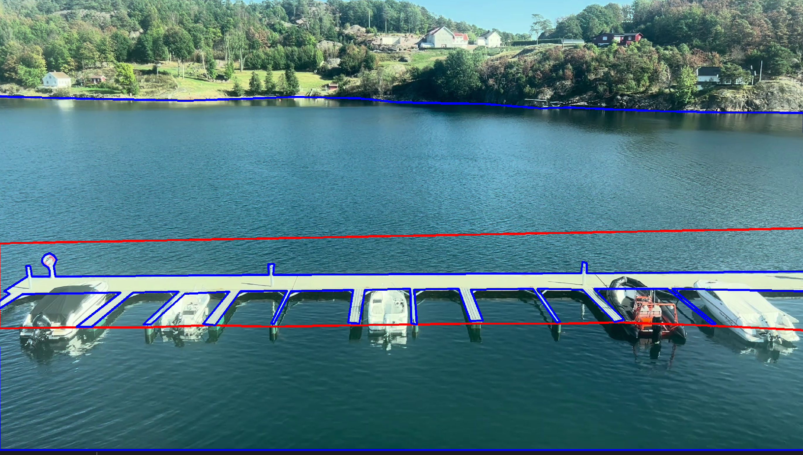
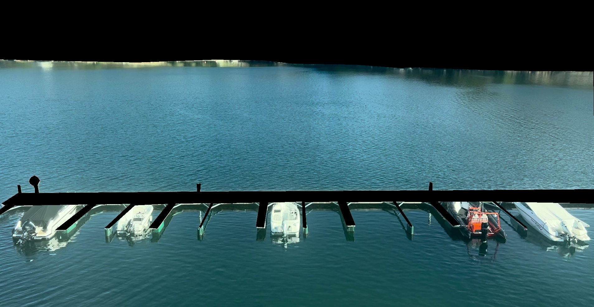
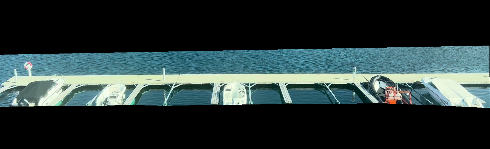

# Motion Detection 
> Historical notes from the initial prototype. Current behaviour, connected model
> tracking, corrected shadow filtering and limitations are documented in
> [architecture.md](architecture.md) and [the README](../README.md). Statements
> below about an unconnected tracker and per-frame mask display describe the old
> release, not the current branch.

*short explainatoin on how the motion detection is made*

## Motion detection 1.0

The first implementation was inspired by the approach presented by LearnOpenCV for moving object detection. The method started with [backround substraction](https://learnopencv.com/moving-object-detection-with-opencv/) using OpenCV's MOG2 background subtractor to generate a foreground mask.

```
backSub = cv2.createBackgroundSubtractorMOG2(detectShadows = True, varThreshold=30)

fg_mask = backSub.apply(frame)
```

 Shadow pixels were removed through thresholding,  followed by morphological opening to reduce noise.
 
```
kernel = cv2.getStructuringElement(cv2.MORPH_ELLIPSE, (3, 3))

retval, mask_thresh = cv2.threshold(fg_mask, 150, 255, cv2.THRESH_BINARY) # cv2.threshold(fg_mask, replace all values under 180 to 0, 255, cv2.THRESH_BINARY )

mask_eroded = cv2.morphologyEx(mask_thresh, cv2.MORPH_OPEN, kernal)
``` 

Contours were then extracted, and objects with an area above a predefined threshold were identified as moving objects and enclosed by bounding boxes.

```
contours, hierarchy = cv2.findContours(mask_eroded, cv2.RETR_EXTERNAL, cv2.CHAIN_APPROX_SIMPLE)

min_contour_area = min_area # minimum area treshold
large_contours = [cnt for cnt in contours if cv2.contourArea(cnt) > min_contour_area]

frame_out = frame.copy()
for cnt in large_contours:
    x, y, w, h = cv2.boundingRect(cnt)
    frame_out = cv2.rectangle(frame, (x, y), (x+w, y+h), (0, 0, 200), 2)
```

This was a simple implementation that did the bear minimum for a motion detection. However the task is on a dock with waves in the backround that moves. So it had a hard time not get false detection of the backround. Therefor version 2.0 were designed. 


## Motion detection 2.0

To improve the motion detection wee needed something that chould ignore the movement in the waves without removing the possibility to se the persons on the dock. To do that we figured it maight be better to devide the fotage into **two sones** to have different tresholds. 

In our security survilence of the dock we chould say there is **two zones**. One for **the dock** and one for the **water**. 

To make these sones we use zones that we clicked the edges in like Herator implemented in the beginning. In this zones we need to make one for the dock and where we "assume" that we can detect people. And a zone where we can assume we can detect boats. Since we know that boats should not be on the dock and not on land we make a zone that removes these areas. In the photo below you can see the two zones. 




Then we need to make the motion detection in the different zones we started with [polygonal masks](https://blog.finxter.com/5-best-ways-to-mask-an-image-in-opencv-python/) to remove sections we are not intrested too look for movement in. We make one for the person detection and one for the boat detection. 
To do this we needed an numpy array, and with the click zone location got stored as json. so startet with converting them to numpy array. 

This made us end up with: 




Since it was going to be configuring two zones the **motion_detection(frame, min_area)** function from version 1 needed some changes, and th eposibility to change configurations based on what zone it tries to detect motion in. 

there was also made two new backSub and kernel to individual decide what threshold the different zones has. 
```
pearson_backSub = cv2.createBackgroundSubtractorMOG2(detectShadows = True, varThreshold=20)
boat_backSub = cv2.createBackgroundSubtractorMOG2( detectShadows = True, varThreshold=50)

pearson_kernel = cv2.getStructuringElement(cv2.MORPH_ELLIPSE, (3, 3))
boat_kernel = cv2.getStructuringElement(cv2.MORPH_ELLIPSE, (10,10))

```

It also uses the motion_detection_maske to make mask in the desired zone. inside of the **motion_detection(frame, zone, min_area, minValue, backSub, kernel)**. (*THIS IS A PROBLEM FOR LATER*)

Then we call on the function inside main and drawes the sones. 


### Motion detection 2.1

Motion detection still gives false positive so, changed a lot of configuration to try to find best methode to do it. changing **min_area**, treshold and etc.:

Add gussion blurre to not detect waves as acceptable motion for the motion detection for boats. added it as one of the parameters for the **motion_detection(frame, zone, min_area, minValue, backSub, kernel, blurre=False)**
The gussian blurred made it easier to not get false positive for waves. 

The **mask_eroded** were also change to **mask_merge** since after testing it seemed liked it chould easier see the boat as one object rather than many objects. 


### Motion detection 2.2

**NOT DONE YET**

Dont draw the mask for every frame. The program is wery slow. 


### Motion detection 2.3

Removed the old dock and water zones (**zones.json** and **params.yaml**), now we only use the motion detection zones in **MDZones.json**.

Persons and boats now get different colors so its easier to see what is what. Person boxes are orange and boat boxes are green. The zones are drawn after the motion detection, so the zone lines dont get counted as motion.

Some videos start with black frames, so we skip those before we make the zones. Otherwise the first frame is just black and you cant click the zones.

The videos are not on github anymore since they are to big, see **media/videos_link.txt**.


## Tracker

**NOT IN USE YET**

The problem with motion detection is that when a person stands still, the box disappears since there is no motion. So we made a **Tracker** in **tracker.py** that keeps the box on the object after it stops moving.

How it works:
- Motion boxes start a new track, or move a track that is close to it (**pad**).
- It remembers what the empty scene looks like (**self.ref**), learned from the MOG2 background. Inside the track boxes it doesnt learn, so a person standing still never becomes part of the background.
- A track with no motion stays as long as its area still looks different from the empty scene. When it looks empty again the person has left and the track is removed.
- Motion boxes where the image looks like the empty scene are ignored, so we dont get "ghost" boxes.

```
tracker = Tracker(diff_threshold=30, min_changed_px=200, pad=20)
tracks = tracker.update(frame, person_boxes, pearson_backSub.getBackgroundImage())
```

It is not connected to **main.py** yet.


## Limitations

- **It doesnt know what the object is.** Anything moving in the person zone gets a person box and anything moving in the boat zone gets a boat box. So a bird or a dog on the dock is a "person", and a person swimming is a "boat".
- **Waves still give false detections sometimes.** The blur helps a lot but big waves or reflections from the sun can still be detected as a boat.
- **The zones only work for one camera angle.** If the camera moves, the zones have to be clicked again.
- **The thresholds are tuned for our videos.** Other light, night, rain or another camera will probably need new values.
- **MOG2 needs time to learn the background.** The first seconds of the video can give wrong boxes, and something that stands still for a long time slowly becomes part of the background and the box disappears. (This is what the tracker is supposed to fix.)
- **Shadows** are mostly removed by the threshold, but strong shadows can still be detected as motion.
- **It is slow.** The mask is made and shown for every frame, see 2.2.
- **Tracker:** if two persons walk close to each other they can become one box. If the light changes a lot, the area can still look "different" from the empty scene so a box can stay after the person has left.


# NB! 
**An AI assistant (Claude) was used for guidance on approach and for help with parts of the code and debugging. The zone design, parameter tuning and the overall structure were done by us.**
